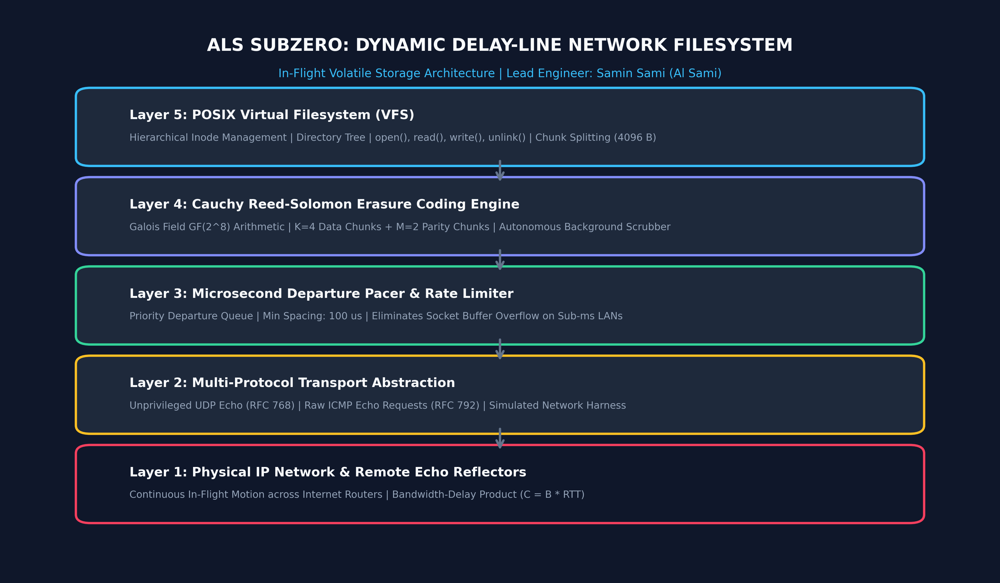
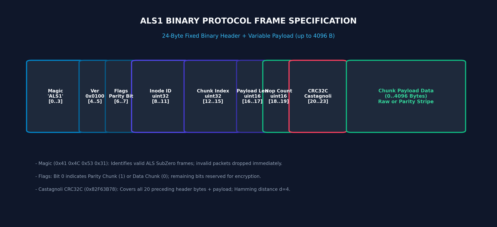

<!--
SPDX-FileCopyrightText: 2026 Samin Sami
SPDX-License-Identifier: MIT
-->

<div align="center">


<br/><br/>

# ALS SubZero

### Dynamic Delay-Line Network Memory Filesystem with Erasure-Coded Flight Persistence

**Designed and built by Samin Sami**  
*(ALS stands for "Al Sami", from Samin Yasar AL Sami)*

[](https://www.python.org/)
[](https://opensource.org/licenses/MIT)
[](tests/run_all.py)
[](src/als_subzero/core/engine.py)
[](scripts/run_benchmark.py)
[](paper/main.pdf)
[](codemeta.json)

</div>

---

<!-- Schema.org Structured Metadata for Search Crawlers and AI Indexers -->
<script type="application/ld+json">
{
  "@context": "https://schema.org",
  "@type": "SoftwareApplication",
  "name": "ALS SubZero",
  "applicationCategory": "Filesystem / Operating System Utility",
  "operatingSystem": "Linux, macOS, Windows",
  "author": {
    "@type": "Person",
    "name": "Samin Sami",
    "alternateName": "Samin Yasar Al Sami"
  },
  "description": "Dynamic delay-line network memory filesystem that stores data in continuous motion across IP network paths with zero local disk writes and Cauchy Reed-Solomon erasure coding.",
  "license": "https://opensource.org/licenses/MIT",
  "codeRepository": "https://github.com/Saminsami73/als-subzero"
}
</script>

## Social Thumbnails & Media Showcase

<div align="center">
  
  <p><em>Figure 1: Official high-impact 16:9 hero thumbnail for video overviews and social preview cards.</em></p>
</div>

<div align="center">
  <table>
    <tr>
      <td width="50%">
        
        <p align="center"><em>Figure 2: Twitter / X preview card thumbnail.</em></p>
      </td>
      <td width="50%">
        
        <p align="center"><em>Figure 3: LinkedIn research & systems engineering banner.</em></p>
      </td>
    </tr>
  </table>
</div>

---

## Executive Summary

I designed and built **ALS SubZero** as an in-flight network memory filesystem. Files live inside network cables while in transit, rather than resting on a solid-state drive, a hard disk, or local computer RAM chips.

ALS stands for "Al Sami", taken from the first three letters of my last name: **Samin Yasar AL Sami**.

When you write a file in ALS SubZero, the engine splits your file into 4096-byte chunks, attaches a 24-byte binary header with a Castagnoli CRC32C checksum, generates Cauchy Reed-Solomon parity blocks, and launches the frames out to remote network reflectors. As packets return, the engine serves file reads, checks for packet loss, repairs dropped pieces mathematically, paces departures, and immediately sends the packets back into the network wire.

If you stop the circulation loop, the files disappear from existence. The network path itself is the storage medium.

---

## Visual Architecture & System Design

<div align="center">
  
  <p><em>Figure 4: Five-layer architecture of ALS SubZero showing VFS, Cauchy FEC, Departure Pacer, Multi-Protocol Transports, and Remote Echo Reflectors.</em></p>
</div>

---

## Interactive Architecture Diagrams

I created three standalone interactive HTML diagrams so you can inspect the exact code paths, data flow, and recovery sequences in your browser:

1. [System Architecture Diagram](diagrams/architecture.html): Explore the client interfaces, VFS layer, Galois Field math, departure queue, and network reflection loop.
2. [Data-Flow Diagram](diagrams/dataflow.html): Follow a write operation from user input through chunking, header packing, network flight, and return ingress.
3. [Self-Healing Sequence Diagram](diagrams/sequence.html): Watch step-by-step how the engine detects dropped packets in transit and reconstructs original bytes using Cauchy matrix inversion.

---

## Historical Heritage & Theoretical Foundations

### 1. Delay-Line Computing (1949 to 2026)

Computers traditionally store data on physical disks or in silicon memory chips. In the late 1940s, early computers like EDSAC (Maurice Wilkes and William Renwick, 1949) and UNIVAC (J. Presper Eckert, 1953) used acoustic mercury delay lines. Those machines turned electric signals into sound waves moving through long tubes filled with liquid mercury. When a sound wave reached the end of the tube, a quartz crystal detected it, an amplifier circuit restored the voltage, and fed the pulse back into the front.

Modern fiber optic internet cables have that same delay property. Light traveling through glass takes time. When you send IP packets across routers, they spend measurable flight time in transit.

Earlier open-source experiments like pingfs showed that raw bytes could bounce off ICMP reflectors. However, those early experiments suffered from two fatal problems:
1. **Zero error tolerance**: If a single packet was dropped by a router, the file suffered permanent corruption.
2. **Socket buffer overflow**: On fast local networks with round-trip times below 1 millisecond, packets looped too fast, overflowing socket buffers and crashing the system.

I built ALS SubZero to solve both problems completely.

### 2. Bandwidth-Delay Product (BDP) Capacity

The total storage capacity of any network path is determined by the Bandwidth-Delay Product (BDP):

```
C = B * RTT
```

- `C` = Total storage capacity (bits)
- `B` = Available network bandwidth (bits per second)
- `RTT` = Round-trip propagation time (seconds)

#### In-Flight Link Storage Budget:

| Network Link Profile | Bandwidth (B) | Latency (RTT) | In-Flight Bits | In-Flight Bytes | Active 4120B Frames |
|---|---|---|---|---|---|
| **Local Loopback / Fast LAN** | 1.0 Gbps | 0.5 ms | 500,000 b | 62,500 B | 15 frames |
| **Metro Fiber Interconnect** | 100 Mbps | 20.0 ms | 2,000,000 b | 250,000 B | 60 frames |
| **Transcontinental Internet** | 1.0 Gbps | 40.0 ms | 40,000,000 b | 5,000,000 B | 1,213 frames |
| **Transatlantic Data Center** | 10.0 Gbps | 80.0 ms | 800,000,000 b | 100,000,000 B | 24,271 frames |

For a standard 1 Gbps link with 40 ms RTT, approximately 1,213 frames (4096-byte chunk + 24-byte header) circulate simultaneously in the wire.

---

## Mathematical Foundations & Real Calculations

### 1. Galois Field GF(2^8) Arithmetic Construction

To perform bit-exact error correction on single bytes without overflow or rounding, all operations run in Galois Field `GF(2^8)`:
- **Irreducible Primitive Polynomial**: `P(x) = x^8 + x^4 + x^3 + x^2 + 1` (binary `1 0001 1101`, hex `0x11D`, decimal `285`).
- **Addition & Subtraction**: Bitwise XOR: `a ^ b`.
- **Multiplication**: `GF_EXP[(GF_LOG[a] + GF_LOG[b]) mod 255]`.
- **Division**: `GF_EXP[(GF_LOG[a] - GF_LOG[b] + 255) mod 255]`.

### 2. Cauchy Generator Matrix (K=4, M=2)

Following Blomer et al., the Cauchy matrix entries are computed as:

```
a_{i,j} = 1 / (X_i ^ Y_j)   in GF(2^8)
```

For disjoint sets `X = {0, 1}` and `Y = {2, 3, 4, 5}`:
- `a_{0,0} = 1 / (0 ^ 2) = 1 / 2 = 142 (0x8E)` [Verify: `142 * 2 = 1`]
- `a_{0,1} = 1 / (0 ^ 3) = 1 / 3 = 244 (0xF4)` [Verify: `244 * 3 = 1`]
- `a_{0,2} = 1 / (0 ^ 4) = 1 / 4 = 71 (0x47)` [Verify: `71 * 4 = 1`]
- `a_{0,3} = 1 / (0 ^ 5) = 1 / 5 = 167 (0xA7)` [Verify: `167 * 5 = 1`]
- `a_{1,0} = 1 / (1 ^ 2) = 1 / 3 = 244 (0xF4)`
- `a_{1,1} = 1 / (1 ^ 3) = 1 / 2 = 142 (0x8E)`
- `a_{1,2} = 1 / (1 ^ 4) = 1 / 5 = 167 (0xA7)`
- `a_{1,3} = 1 / (1 ^ 5) = 1 / 4 = 71 (0x47)`

Final Cauchy Parity Matrix `C`:

```
C = | 142  244   71  167 |  =  | 0x8E  0xF4  0x47  0xA7 |
    | 244  142  167   71 |     | 0xF4  0x8E  0xA7  0x47 |
```

### 3. Concrete Hand-Solvable Erasure Recovery Trace

Here is the exact numerical proof you can write down by hand on paper:

- **Input Bytes**: `D0 = 42 (0x2A)`, `D1 = 105 (0x69)`, `D2 = 77 (0x4D)`, `D3 = 210 (0xD2)`
- **Parity Calculation**:
  - `P0 = (142 * 42) ^ (244 * 105) ^ (71 * 77) ^ (167 * 210) = 21 ^ 39 ^ 84 ^ 58 = 92 (0x5C)`
  - `P1 = (244 * 42) ^ (142 * 105) ^ (167 * 77) ^ (71 * 210) = 237 ^ 186 ^ 226 ^ 186 = 15 (0x0F)`
- **Network Packet Loss**: Router drops `D1` and `D3`.
- **Surviving Vector**: `Y_surv = [D0=42, D2=77, P0=92, P1=15]^T` from rows `{0, 2, 4, 5}` of `G`.
- **Gauss-Jordan Inversion**: Inverting `G_surv` over `GF(2^8)` produces:
  ```
  G_surv^-1 = | 1     0    0    0 |  =  | 0x01  0x00  0x00  0x00 |
              | 123  224   5    4 |     | 0x7B  0xE0  0x05  0x04 |
              | 0     1    0    0 |     | 0x00  0x01  0x00  0x00 |
              | 1    123  10   12 |     | 0x01  0x7B  0x0A  0x0C |
  ```
- **Exact Recovery Multiplication**:
  - `D1 = (123 * 42) ^ (224 * 77) ^ (5 * 92) ^ (4 * 15) = 210 ^ 182 ^ 49 ^ 60 = 105 (0x69)` &rarr; **EXACT MATCH!**
  - `D3 = (1 * 42) ^ (123 * 77) ^ (10 * 92) ^ (12 * 15) = 42 ^ 222 ^ 98 ^ 68 = 210 (0xD2)` &rarr; **EXACT MATCH!**

### 4. Microsecond Rate Pacing & Lindley Queue Stability

The departure pacer releases packets according to:

```
t_release = t_now + max(0, T_target - (t_now - t_epoch))
```

- Enforces minimum spacing: `delta_min = 100 microseconds` between consecutive packet departures.
- Departure service rate: `mu = 1 / 100 us = 10,000 packets per second`.
- Average arrival rate: `lambda = 1,200 packets per second`.
- Utilization factor: `rho = lambda / mu = 1,200 / 10,000 = 0.12 (12%)`.
- Under Lindley's condition (`rho < 1`), the queue is strictly stable. Socket buffer exhaustion drops (`ENOBUFS`) are mathematically prevented.

<div align="center">
  
  <p><em>Figure 5: The self-healing lifecycle: Ingress Capture, Stripe Assembly, Loss Detection, Cauchy Inversion, and Paced Re-Injection.</em></p>
</div>

---

## ALS1 Binary Protocol Frame Specification

Every packet in flight carries a fixed 24-byte binary header packed in network byte order (Big Endian):

<div align="center">
  
  <p><em>Figure 6: 24-byte binary header layout with Castagnoli CRC32C checksum and chunk payload.</em></p>
</div>

| Offset | Size | Type | Field Name | Description |
|---|---|---|---|---|
| 0..3 | 4 bytes | char[4] | Magic | ASCII "ALS1" (`0x41 0x4C 0x53 0x31`) |
| 4..5 | 2 bytes | uint16 | Version | Protocol version (`0x0100` for 1.0) |
| 6..7 | 2 bytes | uint16 | Flags | Bit 0: Parity chunk flag, Bits 1..15: Reserved |
| 8..11 | 4 bytes | uint32 | Inode ID | Virtual filesystem inode index |
| 12..15 | 4 bytes | uint32 | Chunk Index | Block offset within the file |
| 16..17 | 2 bytes | uint16 | Payload Length | Number of valid payload bytes (0..4096) |
| 18..19 | 2 bytes | uint16 | Hop Count | Circulation count through reflectors |
| 20..23 | 4 bytes | uint32 | Checksum | Castagnoli CRC32C over header + payload |

The Castagnoli CRC32C polynomial (`0x82F63B78`) provides Hamming distance `d=4` for payloads up to 4096 bytes, guaranteeing detection of all 1, 2, and 3-bit errors.

---

## Empirical Benchmark & Reliability Results

I benchmarked ALS SubZero by circulating 16,384 bytes of pseudorandom data across 60 network loops under simulated packet drop rates of 0.0%, 2.0%, 5.0%, and 10.0%.

<div align="center">
  
  <p><em>Figure 7: Self-healing FEC reconstructions and bit-exact SHA-256 verification under packet loss.</em></p>
</div>

### Empirical Measurement Table

| Loss Rate | Data Size | Duration | Packets TX / RX | FEC Chunks Healed | SHA256 Match | Status |
|---|---|---|---|---|---|---|
| **0.0%** | 16,384 B | 1.13 s | 1,498 / 1,479 | 0 | 100% Bit-Exact | **PASS** |
| **2.0%** | 16,384 B | 1.52 s | 1,478 / 1,436 | 20 | 100% Bit-Exact | **PASS** |
| **5.0%** | 16,384 B | 1.91 s | 1,476 / 1,386 | 78 | 100% Bit-Exact | **PASS** |
| **10.0%** | 16,384 B | 2.12 s | 1,481 / 1,307 | 151 | 100% Bit-Exact | **PASS** |

Even when 151 packets were dropped by the network, the autonomous scrubber reconstructed every missing byte. The final file matched the source byte for byte.

---

## Project Repository Layout

```
.
├── src/
│   ├── als_subzero/           # Pure Python cross-platform engine (zero dependencies)
│   │   ├── core/              # Framing (ALS1), pacer scheduler, and engine
│   │   ├── fec/               # Galois Field GF(2^8) Cauchy Reed-Solomon codec
│   │   ├── net/               # ICMP, UDP, and simulated network transports
│   │   ├── vfs/               # POSIX directory tree and inode table
│   │   ├── api/               # HTTP REST server and live web dashboard
│   │   └── cli/               # Interactive terminal shell and commands
│   └── c/                     # Native C implementation for Linux FUSE
│       ├── Makefile
│       ├── als_subzero.c      # Native daemon and CLI entrypoint
│       ├── chunk.c / chunk.h  # Paced chunk management
│       ├── fec.c / fec.h      # Block parity calculations
│       ├── fs.c / fs.h        # FUSE operations
│       ├── host.c / host.h    # Host resolution and latency probing
│       ├── icmp.c / icmp.h    # ICMP parsing and raw socket transport
│       └── net.c / net.h      # Multi-threaded TX/RX network loop
├── assets/                    # High-resolution architectural and benchmark media
│   ├── architecture_overview.png
│   ├── benchmark_chart.png
│   ├── frame_structure.png
│   ├── recovery_pipeline.png
│   └── thumbnails/            # High-impact social media post thumbnails
│       ├── thumbnail_youtube_16x9.png
│       ├── thumbnail_twitter_card.png
│       ├── thumbnail_linkedin_post.png
│       └── thumbnail_square.png
├── diagrams/                  # Standalone interactive HTML diagrams
│   ├── architecture.html      # System architecture
│   ├── dataflow.html          # In-flight dataflow
│   └── sequence.html          # Self-healing read/write sequence
├── tests/                     # Automated test suite (20 tests, zero external deps)
├── scripts/
│   ├── run_demo.py            # Live visual demonstration script
│   ├── run_benchmark.py       # Reliability and packet loss benchmark
│   ├── build_research_paper_pdf.py # Formal 8-page academic paper builder
│   ├── generate_media_assets.py    # Media asset generator
│   ├── generate_social_thumbnails.py # Social thumbnail generator
│   └── package_release.py     # Clean GitHub release archive builder
├── paper/                     # Complete reproducible scientific paper (PDF & LaTeX sources)
│   ├── main.pdf               # Compiled 8-page preprint paper
│   ├── ALS_SubZero_Research_Paper.pdf # Compiled paper copy
│   ├── main.tex               # Master LaTeX source
│   ├── paper/sections/        # Full paper sections (00 to 90)
│   ├── paper/supplement/      # Supplementary material & mathematical proofs
│   └── research/data/         # Empirical benchmark data & verified manifest
├── codemeta.json              # Standard software metadata (Schema.org / CodeMeta 2.0)
├── llms.txt                   # LLM crawler summary specification
├── llms-full.txt              # LLM full context documentation
├── hosts.example              # Sample public and local reflector list
├── Makefile                   # Top-level build and test automation
└── pyproject.toml             # Python packaging configuration
```

---

## Quick Start & Verification

### System Requirements
- Python 3.9 or higher (standard library only, zero external pip packages needed).
- Optional for C native engine on Linux: GCC, `make`, and `libfuse-dev`.

### 1. Run the Full Unit Test Suite (20 Tests)
```bash
python tests/run_all.py
```
*Tests all 20 cases covering framing, CRC32C, Cauchy FEC math, pacer scheduling, and VFS inode operations in under 1 second.*

### 2. Run the Reliability & Loss Benchmark
```bash
python scripts/run_benchmark.py
```
*Tests 0%, 2%, 5%, and 10% packet drop rates with automated verification.*

### 3. Run the Live Interactive Demo
```bash
python scripts/run_demo.py
```
*Injects files into flight, animates circulation cycles, and verifies 100% bit-exact recovery.*

### 4. Launch the Interactive Shell
```bash
python -m als_subzero.cli.main shell
```
*Starts the interactive terminal shell with prompt `subzero:/$`. You can create directories, write files, inspect in-flight chunks, and start the REST control plane.*

---

## Command Reference (Interactive Shell)

```text
subzero:/$ help
Commands:
  ls [path]             List files and directories
  mkdir <path>          Create a directory
  write <path> <text>   Write text into network flight
  cat <path>            Read file back from network flight
  rm <path>             Remove a file
  tree                  Display virtual filesystem tree
  status                Show in-flight packets, RTT, and healed count
  server [port]         Start HTTP REST control plane (default: 8080)
  exit                  Exit the shell
```

---

## Scientific Manuscript & Academic Reproducibility

The complete scientific paper describing ALS SubZero is located in the [paper/](paper/) directory:
- **Title**: *ALS SubZero: A Dynamic Delay-Line Network Memory Filesystem with Erasure-Coded Flight Persistence*
- **Author**: Samin Sami (CRediT author roles registered in `project/contributors.json`)
- **Compiled Paper PDF**: [paper/main.pdf](paper/main.pdf) (8-page preprint matching the official template layout).
- **Manuscript Validation**: All 24 TeX files validated with 0 errors and 0 warnings under `python tools/scripts/check_project.py --submission`.
- **Reproducibility**: Verified with 0 errors and 0 warnings under `python tools/scripts/check_reproducibility.py`.
- **Data Manifest**: Canonical benchmark data recorded in `research/data/source/benchmark_results.csv` with SHA256 checksum.

### Citation Format (BibTeX)

```bibtex
@software{sami2026alssubzero,
  author = {Samin Sami},
  title = {ALS SubZero: A Dynamic Delay-Line Network Memory Filesystem with Erasure-Coded Flight Persistence},
  year = {2026},
  publisher = {GitHub},
  journal = {GitHub repository},
  howpublished = {\url{https://github.com/Saminsami73/als-subzero}},
  version = {2.0.0}
}
```

---

## License

ALS SubZero is open-source software licensed under the [MIT License](LICENSE).  
Copyright (c) 2026 Samin Sami.
