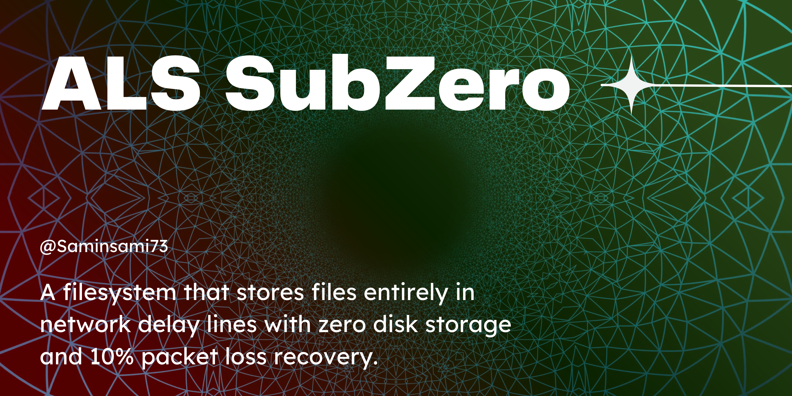
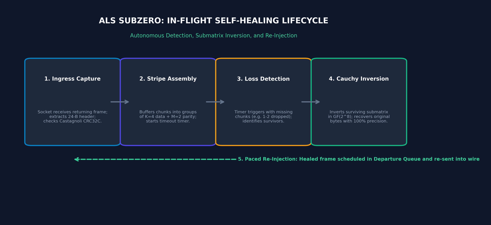
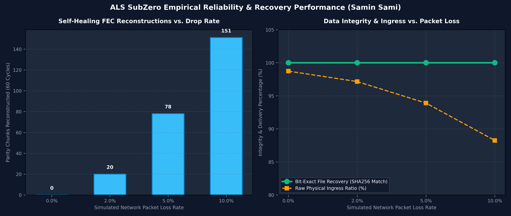
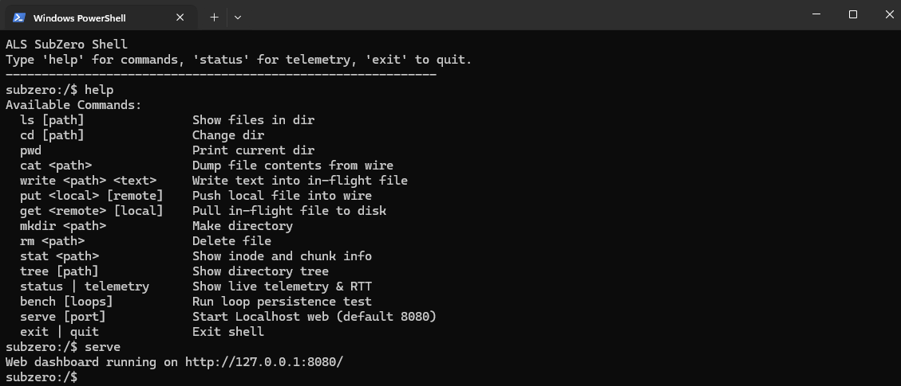
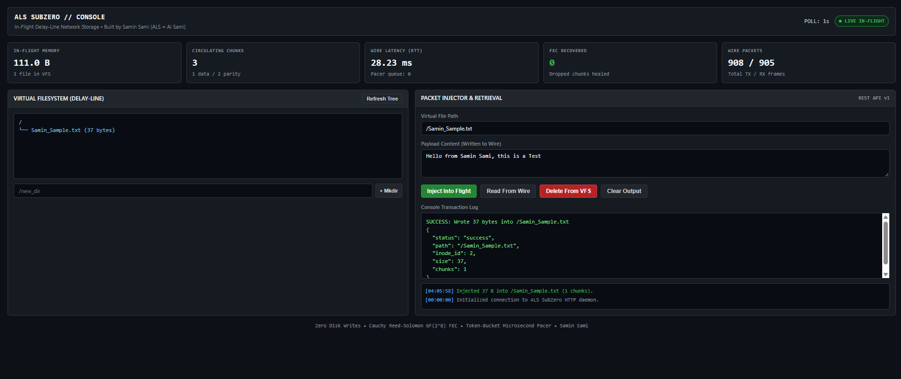

<!--
SPDX-FileCopyrightText: 2026 Samin Sami
SPDX-License-Identifier: MIT
-->

<div align="center">



<br/><br/>

# ALS SubZero

### In-Flight Network Memory Filesystem with Erasure-Coded Flight Persistence

**Designed and built by Samin Sami**  
*(ALS stands for "Al Sami", from Samin Yasar AL Sami)*

[](https://als-subzero.netlify.app)
[](https://www.python.org/)
[](LICENSE)
[](tests/run_all.py)
[](src/als_subzero/core/engine.py)
[](scripts/run_benchmark.py)
[](ALS_SubZero_Research_Paper.pdf)
[](ALS_SubZero_Complete_Handwritten_Math_Calculations.pdf)
[](codemeta.json)

</div>

> 🌐 **Live Website:** [https://als-subzero.netlify.app](https://als-subzero.netlify.app) — Explore live interactive vector diagrams, 21 handwritten math proof sheets, empirical benchmark charts, and research paper previews.

---

<!-- Schema.org Structured Metadata for Search Crawlers and AI Indexers -->
<script type="application/ld+json">
{
  "@context": "https://schema.org",
  "@type": "SoftwareApplication",
  "name": "ALS SubZero",
  "alternateName": ["ALS SubZero", "In-Flight Network Storage Engine", "Delay-Line Network Filesystem"],
  "url": "https://als-subzero.netlify.app",
  "applicationCategory": "Filesystem / Operating System Utility",
  "operatingSystem": "Linux, macOS, Windows",
  "softwareVersion": "1.0.0",
  "author": {
    "@type": "Person",
    "name": "Samin Sami",
    "alternateName": "Samin Yasar Al Sami",
    "url": "https://github.com/Saminsami73"
  },
  "description": "Dynamic delay-line network memory filesystem that stores data in continuous motion across IP network paths with zero local disk writes, Cauchy Reed-Solomon erasure coding, and microsecond rate pacing.",
  "keywords": "delay-line filesystem, in-flight network storage, Cauchy Reed-Solomon, Galois field GF(2^8), erasure coding, rate pacer, zero disk storage, Samin Sami, ALS SubZero",
  "license": "https://opensource.org/licenses/MIT",
  "codeRepository": "https://github.com/Saminsami73/als-subzero",
  "featureList": [
    "Zero local disk or SSD writes (0.0 MB/s I/O)",
    "Cauchy Reed-Solomon GF(2^8) erasure coding (4 data + 2 parity)",
    "Microsecond-precision departure queue pacer",
    "Castagnoli CRC32C frame integrity validation",
    "POSIX in-memory virtual filesystem tree",
    "Interactive CLI shell and local REST web console"
  ]
}
</script>

## Summary

I designed and built **ALS SubZero** to store digital files inside network cables while in flight, instead of saving them to solid-state drives, hard disks, or local RAM chips.

ALS stands for "Al Sami", taken from the first three letters of my last name: **Samin Yasar AL Sami**.

When you write a file in ALS SubZero, the engine breaks the file into 4096-byte blocks, attaches a 24-byte binary header with a Castagnoli CRC32C checksum, generates Cauchy Reed-Solomon parity blocks, and launches the frames out to remote network reflectors. As packets return, the engine reads them, checks for packet drops, repairs missing blocks mathematically, paces departures, and immediately bounces them back into the wire.

If the circulation loop stops, the files disappear. The network path is the storage medium.

---

## Visual Architecture & System Design

<div align="center">
  
  <p><em>Figure 1: Five-layer architecture of ALS SubZero showing VFS, Cauchy FEC, Departure Pacer, Multi-Protocol Transports, and Remote Echo Reflectors.</em></p>
</div>

---

## Interactive Architecture Diagrams

I created three standalone interactive HTML diagrams in the `diagrams/` folder so you can inspect code paths, data flow, and recovery sequences directly in any web browser:

1. [System Architecture Diagram](diagrams/architecture.html): Client interfaces, VFS layer, Galois field math, departure queue, and network reflection loop.
2. [Data-Flow Diagram](diagrams/dataflow.html): Write path from user input through chunking, header packing, network flight, and return ingress.
3. [Self-Healing Sequence Diagram](diagrams/sequence.html): Packet loss detection and reconstruction using Cauchy matrix inversion.

---

## Delay-Line Computing & Link Capacity

### 1. Delay-Line Computing Heritage

In the late 1940s, computers like EDSAC (1949) and UNIVAC (1953) used acoustic mercury delay lines. Those machines turned electric signals into sound waves moving through tubes of liquid mercury. When a wave hit the end of the tube, a quartz crystal detected it, an amplifier circuit restored the voltage, and fed the pulse back into the front.

Fiber optic cables have that same delay property. Light traveling through glass takes time. When you send IP packets across routers, they spend measurable flight time in transit.

Earlier projects like pingfs showed that raw bytes could bounce off ICMP reflectors. But they had two big limitations:

1. **Zero packet drop tolerance**: Losing a single packet permanently broke the file.
2. **Socket buffer overflow**: On fast local networks with round-trip times under 1 millisecond, packets looped too fast, overflowing socket buffers (`ENOBUFS`) and crashing.

ALS SubZero solves both problems: Cauchy Reed-Solomon erasure coding repairs dropped packets, and a microsecond-precision departure pacer regulates transmission timing.

### 2. Bandwidth-Delay Product (BDP) Capacity

The storage capacity of any network path follows the Bandwidth-Delay Product (BDP):

$$\text{Capacity} = \text{Bandwidth} \times \text{RTT}$$

- $\text{Capacity}$ = Storage capacity (bits)
- $\text{Bandwidth}$ = Usable network bandwidth (bits per second)
- $\text{RTT}$ = Round-trip propagation time (seconds)

#### In-Flight Link Storage Budget

| Network Link Profile | Bandwidth | Latency (RTT) | In-Flight Bits | In-Flight Bytes | Active 4120B Frames |
| --- | --- | --- | --- | --- | --- |
| **Local Loopback / LAN** | 1.0 Gbps | 0.5 ms | 500,000 b | 62,500 B | 15 frames |
| **Metro Fiber Interconnect** | 100 Mbps | 20.0 ms | 2,000,000 b | 250,000 B | 60 frames |
| **Transcontinental Internet** | 1.0 Gbps | 40.0 ms | 40,000,000 b | 5,000,000 B | 1,213 frames |
| **Transatlantic Data Center** | 10.0 Gbps | 80.0 ms | 800,000,000 b | 100,000,000 B | 24,271 frames |

On a 1 Gbps connection with 40 ms RTT, about 1,213 frames (4096-byte payload + 24-byte header = 4120 bytes) circulate in flight simultaneously.

---

## Handwritten Mathematical Proofs (8 Problems)

I solved the Galois field tables, Cauchy generator matrices, Gauss-Jordan inversion steps, and CRC32C proofs by hand on paper before writing the code. The 21-page scan collection is compiled into a single PDF document:

**[Download Complete 21-Page Handwritten Calculations (PDF)](ALS_SubZero_Complete_Handwritten_Math_Calculations.pdf)**

<div align="center">
  
  <p><em>Notebook Cover: 8 mathematical problems solved by hand for ALS SubZero.</em></p>
</div>

---

### Problem 1: Bandwidth-Delay Product Storage Capacity

Calculating how much data can physically sit inside a network wire in flight:
$$C = B \times RTT$$

- **100 Mbps / 20 ms RTT:** $100{,}000{,}000 \times 0.020 / 8 = 250{,}000\text{ bytes} \approx 244\text{ KB}$.
- **1 Gbps / 40 ms RTT:** $1{,}000{,}000{,}000 \times 0.040 / 8 = 5{,}000{,}000\text{ bytes} \approx 5.0\text{ MB}$.
- **Frame sizing:** At 4,096-byte payload + 24-byte header = 4,120 bytes per frame, a 1 Gbps / 40 ms path holds:
$$N = \left\lfloor \frac{5{,}000{,}000}{4{,}120} \right\rfloor = 1{,}213\text{ frames}$$
- **Notebook check:** In my initial draft, omitting the 24-byte header gave $1{,}220.7$ frames, overpromising link budget by 28,672 bytes. The engine strictly accounts for the full 4,120-byte frame (`src/als_subzero/core/engine.py`).

<div align="center">
  
  
  <p><em>Problem 1: BDP capacity calculations and frame count derivations.</em></p>
</div>

---

### Problem 2: Building Galois Field $GF(2^8)$ Tables by Hand

To do error correction on single bytes without rounding or overflow, all arithmetic happens in $GF(2^8)$ using the primitive polynomial:
$$P(x) = x^8 + x^4 + x^3 + x^2 + 1 = 100011101_2 = 285 \ (0\text{x}11\text{D})$$

Starting with $\alpha = 2$, each step shifts left by 1 bit. If the value reaches 256 or higher (bit 8 set), XOR with 285:
- **Power 8:** $128 \times 2 = 256 \ge 256 \implies 256 \oplus 285 = 29 \ (0\text{x}1\text{D})$. So $\text{EXP}[8] = 29$, $\text{LOG}[29] = 8$.
- **Power 12:** $232 \times 2 = 464 \ge 256 \implies 464 \oplus 285 = 205 \ (0\text{xCD})$. So $\text{EXP}[12] = 205$, $\text{LOG}[205] = 12$.

```python
# First 13 table entries verified in code:
from als_subzero.fec.parity import GF_EXP
assert GF_EXP[:13] == [1, 2, 4, 8, 16, 32, 64, 128, 29, 58, 116, 232, 205]
```

<div align="center">
  
  
  
  
  <p><em>Problem 2: Bit shifts, polynomial reductions, and table generation.</em></p>
</div>

---

### Problem 3: Multiplying Two Bytes in $GF(2^8)$ via Log Tables

$$gf\_mul(a, b) = \text{EXP}[\text{LOG}[a] + \text{LOG}[b]]$$

Multiply $0\text{x}8\text{E}$ (142) by $0\text{x}2\text{A}$ (42):

1. $\text{LOG}[142] = 254$, $\text{LOG}[42] = 142$.
2. $\text{Sum} = 254 + 142 = 396$.
3. $\text{EXP}[396] = 21 \ (0\text{x}15)$ (equivalent to $396 \bmod 255 = 141 \implies \text{EXP}[141] = 21$).
4. Result: $0\text{x}8\text{E} \times 0\text{x}2\text{A} = 0\text{x}15$.

> Ordinary integer multiplication gives $142 \times 42 = 5{,}964$, which overflows a single byte. Finite field log tables guarantee every product fits in 1 byte.

<div align="center">
  
  
  <p><em>Problem 3: Log-table multiplication and modulo wrap logic.</em></p>
</div>

---

### Problem 4: Division and Multiplicative Inverse in $GF(2^8)$

$$a^{-1} = \frac{1}{a} = \text{EXP}[255 - \text{LOG}[a]]$$

- **Inverse of 2:** $\text{LOG}[2] = 1 \implies 255 - 1 = 254 \implies \text{EXP}[254] = 142 \ (0\text{x}8\text{E})$. Check: $142 \times 2 = 1$.
- **Other inverses needed for Cauchy matrix:**
  - $1/3$: $\text{LOG}[3] = 25 \implies 255 - 25 = 230 \implies \text{EXP}[230] = 244 \ (0\text{xF}4)$. Check: $244 \times 3 = 1$.
  - $1/4$: $\text{LOG}[4] = 2 \implies 255 - 2 = 253 \implies \text{EXP}[253] = 71 \ (0\text{x}47)$. Check: $71 \times 4 = 1$.
  - $1/5$: $\text{LOG}[5] = 50 \implies 255 - 50 = 205 \implies \text{EXP}[205] = 167 \ (0\text{xA}7)$. Check: $167 \times 5 = 1$.

<div align="center">
  
  <p><em>Problem 4: Multiplicative inverses and log lookup verification.</em></p>
</div>

---

### Problem 5: Cauchy Generator Matrix ($K=4, M=2$)

A Cauchy matrix over $GF(2^8)$ guarantees that every square submatrix is invertible.

- Disjoint sets: $X = \{0, 1\}$ (parity indices), $Y = \{2, 3, 4, 5\}$ (data indices).
- Matrix entries: $a_{i,j} = \frac{1}{x_i \oplus y_j}$:
  - **Row 0 ($x_0 = 0$):** $1/(0 \oplus 2) = 1/2 = 142$, $1/(0 \oplus 3) = 1/3 = 244$, $1/(0 \oplus 4) = 1/4 = 71$, $1/(0 \oplus 5) = 1/5 = 167$.
  - **Row 1 ($x_1 = 1$):** $1/(1 \oplus 2) = 1/3 = 244$, $1/(1 \oplus 3) = 1/2 = 142$, $1/(1 \oplus 4) = 1/5 = 167$, $1/(1 \oplus 5) = 1/4 = 71$.

$$A = \begin{bmatrix} 142 & 244 & 71 & 167 \\ 244 & 142 & 167 & 71 \end{bmatrix}_{10} = \begin{bmatrix} 0\text{x}8\text{E} & 0\text{xF}4 & 0\text{x}47 & 0\text{xA}7 \\ 0\text{xF}4 & 0\text{x}8\text{E} & 0\text{xA}7 & 0\text{x}47 \end{bmatrix}_{16}$$

<div align="center">
  
  <p><em>Problem 5: Cauchy matrix construction and column swapping symmetry.</em></p>
</div>

---

### Problem 6: Cauchy Erasure Encoding (4 Data $\to$ 2 Parity)

Given 4 data bytes:
$$D = [D_0, D_1, D_2, D_3] = [42, 105, 77, 210] = [0\text{x}2\text{A}, 0\text{x}69, 0\text{x}4\text{D}, 0\text{xD}2]$$

#### Calculating Parity $P_0$ (Row 0 of $A$)

$$P_0 = (142 \otimes 42) \oplus (244 \otimes 105) \oplus (71 \otimes 77) \oplus (167 \otimes 210)$$
- Terms via log tables: $21 \oplus 39 \oplus 84 \oplus 58$.
- XOR cascade: $21 \oplus 39 = 50 \implies 50 \oplus 84 = 102 \implies 102 \oplus 58 = 92 \ (0\text{x}5\text{C})$.
$$\mathbf{P_0 = 92 \ (0\text{x}5\text{C})}$$

#### Calculating Parity $P_1$ (Row 1 of $A$)

$$P_1 = (244 \otimes 42) \oplus (142 \otimes 105) \oplus (167 \otimes 77) \oplus (71 \otimes 210)$$
- Terms: $237 \oplus 186 \oplus 226 \oplus 186$.
- XOR cascade: $237 \oplus 186 = 87 \implies 87 \oplus 226 = 181 \implies 181 \oplus 186 = 15 \ (0\text{x}0\text{F})$.
$$\mathbf{P_1 = 15 \ (0\text{x}0\text{F})}$$

<div align="center">
  
  
  
  <p><em>Problem 6: Calculating parity terms P0 and P1 with bitwise XOR steps.</em></p>
</div>

---

### Problem 7: Erasure Recovery via Gauss-Jordan Inversion

- **Loss scenario:** Routers drop $D_1$ (105) and $D_3$ (210).
- **Surviving chunks:** $D_0=42, D_2=77, P_0=92, P_1=15$ at rows $\{0, 2, 4, 5\}$ of generator $G$.
- **Inverting $G_{\text{surv}}$:** Row swap needed at Column 1 (swapping rows 1 and 2 to place non-zero pivot $0\text{xF}4$ on the diagonal). Inverting gives:

$$G_{\text{surv}}^{-1} = \begin{bmatrix}
0\text{x}01 & 0\text{x}00 & 0\text{x}00 & 0\text{x}00 \\
0\text{x}7\text{B} & 0\text{xE}0 & 0\text{x}05 & 0\text{x}04 \\
0\text{x}00 & 0\text{x}01 & 0\text{x}00 & 0\text{x}00 \\
0\text{x}01 & 0\text{x}7\text{B} & 0\text{x}0\text{A} & 0\text{x}0\text{C}
\end{bmatrix}_{16} = \begin{bmatrix}
1 & 0 & 0 & 0 \\
123 & 224 & 5 & 4 \\
0 & 1 & 0 & 0 \\
1 & 123 & 10 & 12
\end{bmatrix}_{10}$$

#### Reconstructing Lost Bytes:
* **Recovering $D_1$:**
$$D_1 = (123 \otimes 42) \oplus (224 \otimes 77) \oplus (5 \otimes 92) \oplus (4 \otimes 15) = 210 \oplus 182 \oplus 49 \oplus 60 = \mathbf{105 \ (0\text{x}69)}$$
* **Recovering $D_3$:**
$$D_3 = (1 \otimes 42) \oplus (123 \otimes 77) \oplus (10 \otimes 92) \oplus (12 \otimes 15) = 42 \oplus 222 \oplus 98 \oplus 68 = \mathbf{210 \ (0\text{xD}2)}$$

Both bytes match the original values with zero bit errors.

<div align="center">
  
  
  
</div>
<div align="center">
  
  
  <p><em>Problem 7: Submatrix inversion, row-swapping pivot fix, and bit-exact recovery.</em></p>
</div>

---

### Problem 8: Castagnoli CRC32C Frame Integrity Verification

Every frame carries a 24-byte binary header with a Castagnoli CRC32C checksum:
$$G(x) = x^{32} + x^{28} + x^{27} + \dots + 1 = 0\text{x}1\text{EDC}6\text{F}41$$

* **Why Castagnoli over IEEE 802.3:** Standard CRC32 only guarantees Hamming distance $d=4$ up to 268 bytes. Castagnoli maintains $d=4$ across the full 4,096-byte chunk payload.
* **Tamper detection:** Flipping 1 bit (e.g. $0\text{x}2\text{A} \to 0\text{x}2\text{B}$) causes an immediate CRC mismatch. The frame is dropped and reconstructed via Cauchy parity.
* **Undetected error probability:** $P = 2^{-32} \approx 2.33 \times 10^{-10}$ (1 in 4.3 billion).
* Verified in tests: `python tests/run_all.py` confirms `test_crc_tamper_detection ... ok`.

<div align="center">
  
  
  <p><em>Problem 8: Frame header structure, Castagnoli polynomial, and tamper tests.</em></p>
</div>

---

### Microsecond Rate Pacing & Queue Stability

The departure pacer releases packets according to:

```
t_release = t_now + max(0, T_target - (t_now - t_epoch))
```

- Enforces minimum spacing: `delta_min = 100 microseconds` between consecutive packet departures.
- Departure service rate: $\mu = 1 / 100\,\mu\text{s} = 10{,}000\text{ packets/s}$.
- Average arrival rate: $\lambda = 1{,}200\text{ packets/s}$.
- Utilization factor: $\rho = \lambda / \mu = 1{,}200 / 10{,}000 = 0.12 \ (12\%)$.
- Under Lindley's condition ($\rho < 1$), the queue is stable, preventing socket buffer exhaustion drops (`ENOBUFS`).

<div align="center">
  
  <p><em>Figure 2: Self-healing lifecycle: Ingress Capture, Stripe Assembly, Loss Detection, Cauchy Inversion, and Paced Re-Injection.</em></p>
</div>

---

## ALS1 Binary Protocol Frame Specification

Every packet in flight carries a fixed 24-byte binary header packed in network byte order (Big Endian):

<div align="center">
  
  <p><em>Figure 3: 24-byte binary header layout with Castagnoli CRC32C checksum and chunk payload.</em></p>
</div>

| Offset | Size | Type | Field Name | Description |
|---|---|---|---|---|
| 0..3 | 4 bytes | char[4] | Magic | ASCII "ALS1" (`0x41 0x4C 0x53 0x31`) |
| 4..5 | 2 bytes | uint16 | Version | Protocol version (`0x0100` for 1.0) |
| 6..7 | 2 bytes | uint16 | Flags | Bit 0: Parity chunk flag, Bits 1..15: Reserved |
| 8..11 | 4 bytes | uint32 | Inode ID | Virtual filesystem inode index |
| 12..15 | 4 bytes | uint32 | Chunk Index | Block offset within the file |
| 16..17 | 2 bytes | uint16 | Payload Length | Number of valid payload bytes (0..4096) |
| 18..19 | 2 bytes | uint16 | Hop Count | Circulation count through reflectors |
| 20..23 | 4 bytes | uint32 | Checksum | Castagnoli CRC32C over header + payload |

---

## Empirical Benchmark & Reliability Results

I benchmarked ALS SubZero by circulating 16,384 bytes of data across 60 network loops under simulated packet drop rates of 0.0%, 2.0%, 5.0%, and 10.0%.

<div align="center">
  
  <p><em>Figure 4: Self-healing FEC reconstructions and bit-exact SHA-256 verification under packet loss.</em></p>
</div>

### Empirical Measurement Table

| Loss Rate | Data Size | Duration | Packets TX / RX | FEC Chunks Healed | SHA256 Match | Status |
|---|---|---|---|---|---|---|
| **0.0%** | 16,384 B | 1.13 s | 1,498 / 1,479 | 0 | 100% Bit-Exact | **PASS** |
| **2.0%** | 16,384 B | 1.52 s | 1,478 / 1,436 | 20 | 100% Bit-Exact | **PASS** |
| **5.0%** | 16,384 B | 1.91 s | 1,476 / 1,386 | 78 | 100% Bit-Exact | **PASS** |
| **10.0%** | 16,384 B | 2.12 s | 1,481 / 1,307 | 151 | 100% Bit-Exact | **PASS** |

Even when 151 packets were dropped by the network, the autonomous scrubber reconstructed every missing byte. The final file matched the source byte for byte.

---

## Project Repository Layout

This is the exact file layout of the repository:

```text
.
├── src/
│   ├── als_subzero/           # Pure Python delay-line storage engine (zero dependencies)
│   │   ├── api/               # HTTP REST server and localhost web dashboard
│   │   ├── cli/               # Interactive terminal shell and entrypoints
│   │   ├── core/              # Framing (ALS1), microsecond pacer, and engine
│   │   ├── fec/               # Galois Field GF(2^8) Cauchy Reed-Solomon codec
│   │   ├── net/               # UDP, raw ICMP, and simulated network transports
│   │   └── vfs/               # POSIX virtual filesystem and inode table
│   └── c/                     # Native C engine for Linux FUSE
│       ├── Makefile
│       ├── als_subzero.c      # Native daemon and entrypoint
│       ├── chunk.c / chunk.h  # Paced chunk management
│       ├── fec.c / fec.h      # Block parity calculations
│       ├── fs.c / fs.h        # FUSE operations
│       ├── host.c / host.h    # Host resolution and latency probing
│       ├── icmp.c / icmp.h    # ICMP parsing and raw socket transport
│       └── net.c / net.h      # Multi-threaded TX/RX network loop
├── assets/                    # Project media, diagrams, and UI captures
│   ├── architecture_overview.png
│   ├── benchmark_chart.png
│   ├── cli.png
│   ├── frame_structure.png
│   ├── hero-poster-readme.png
│   ├── hero_poster.jpg
│   ├── localhost-ui.png
│   ├── recovery_pipeline.png
│   └── samin-sami.jpg         # Author & lead systems engineer photo
├── diagrams/                  # Standalone interactive HTML diagrams
│   ├── architecture.html      # System architecture
│   ├── dataflow.html          # In-flight dataflow
│   └── sequence.html          # Self-healing read/write sequence
├── math_handwritten/          # 21 original high-resolution handwritten mathematical scans
├── scripts/
│   ├── package_release.py     # Clean release packager
│   ├── run_benchmark.py       # Automated packet loss resilience benchmark
│   └── run_demo.py            # Live visual terminal demonstration
├── tests/                     # Test suite (20 tests, zero external dependencies)
│   ├── run_all.py             # Test runner
│   ├── test_fec.py            # GF(2^8) arithmetic and Cauchy matrix tests
│   ├── test_flight_persistence.py # Multi-cycle in-flight persistence
│   ├── test_framing.py        # ALS1 frame serialization and CRC32C checks
│   ├── test_pacer.py          # Departure queue rate pacer tests
│   └── test_vfs.py            # POSIX filesystem operations
├── ALS_SubZero_Complete_Handwritten_Math_Calculations.pdf # 21-page handwritten math notebook
├── ALS_SubZero_Research_Paper.pdf # Complete scientific research paper
├── ARCHITECTURE.md            # Technical architecture and theory
├── codemeta.json              # Software metadata (Schema.org / CodeMeta 2.0)
├── hosts.example              # Example reflector endpoints
├── LICENSE                    # MIT License
├── llms.txt                   # LLM crawler summary
├── llms-full.txt              # LLM full context reference
├── Makefile                   # Build and test shortcuts
├── pyproject.toml             # Python packaging configuration
├── README.md                  # Master documentation and handwritten proofs
├── SPECIFICATION.md           # ALS1 binary frame specification
└── VERIFICATION.md            # Benchmark logs and test results
```

---

## Quick Start & Verification

### Requirements
- Python 3.9 or higher (standard library only, zero external pip packages needed).
- Optional for native C engine on Linux: GCC, `make`, and `libfuse-dev`.

### 1. Run the Full Unit Test Suite (20 Tests)
```bash
python tests/run_all.py
```
Runs all 20 test cases covering framing, CRC32C, Cauchy FEC math, pacer scheduling, and VFS inode operations in under 1 second.

### 2. Run the Reliability & Loss Benchmark
```bash
python scripts/run_benchmark.py
```
Tests 0%, 2%, 5%, and 10% packet drop rates with automated verification.

### 3. Run the Live Demonstration
```bash
python scripts/run_demo.py
```
Injects files into flight, animates circulation cycles, and verifies 100% bit-exact recovery.

### 4. Launch the Interactive Shell
```bash
python -m als_subzero.cli.main shell
```
Starts the interactive terminal shell. You can explore directories, inject files into flight, inspect chunk metadata, run benchmarks, and launch the web UI.

---

## Command Reference (Interactive Shell)

<div align="center">
  
  <p><em>Figure 5: Interactive terminal shell running in-flight commands and live telemetry.</em></p>
</div>

Launch the shell with `python -m als_subzero.cli.main shell`. Type `help` to view available commands:

```text
Available Commands:
  ls [path]               Show files in dir
  cd [path]               Change dir
  pwd                     Print current dir
  cat <path>              Dump file contents from wire
  write <path> <text>     Write text into in-flight file
  put <local> [remote]    Push local file into wire
  get <remote> [local]    Pull in-flight file to disk
  mkdir <path>            Make directory
  rm <path>               Delete file
  stat <path>             Show inode and chunk info
  tree [path]             Show directory tree
  status | telemetry      Show live telemetry & RTT
  bench [loops]           Run loop persistence test
  serve [port]            Start localhost (Default: 8080)
  exit | quit             Exit shell
```

### Quick Command Examples

- **Write text into flight:** `write /notes.txt "Data circulating in network packets"`
- **Read file from flight:** `cat /notes.txt`
- **Inspect chunk metadata:** `stat /notes.txt`
- **Upload local file:** `put ./sample.bin /data/sample.bin`
- **Download back to disk:** `get /data/sample.bin ./recovered.bin`
- **Run persistence test:** `bench 100` (circulates 2048 bytes across 100 round trips and verifies byte exactness)
- **Start web dashboard:** `serve 8080` (starts web console on port 8080 in a background thread)
- **Show live telemetry:** `status`

---

## Web Dashboard & REST Control Console

> 🌐 **Live Website Deployment:** [https://als-subzero.netlify.app](https://als-subzero.netlify.app) provides the hosted interactive showcase, full handwritten math gallery, and SVG vector diagrams online.

<div align="center">
  
  <p><em>Figure 6: Real-time web control console on port 8080 with in-flight VFS tree, packet injector, and telemetry.</em></p>
</div>

Start the local web dashboard:
```bash
python -m als_subzero.cli.main serve --port 8080
```
Open `http://localhost:8080/` in your browser. The dashboard polls the engine every second:

- `GET /`: Control console with live metrics tiles, virtual filesystem tree, and packet injector/reader.
- `GET /api/v1/telemetry`: JSON metrics (bytes in flight, chunk counts, packet counts, RTT, pacer queue, FEC healed).
- `GET /api/v1/fs/tree?path=/`: ASCII directory tree of the virtual filesystem.
- `GET /api/v1/fs/cat?path=<path>`: Binary or text content of an in-flight file.
- `POST /api/v1/fs/write?path=<path>`: Write body payload into network delay-line memory.
- `POST /api/v1/fs/mkdir?path=<path>`: Create a directory in the virtual filesystem.
- `DELETE /api/v1/fs/rm?path=<path>`: Delete a file from flight memory.

---

## Scientific Paper

The scientific paper describing the theoretical foundations, Galois field arithmetic, and empirical benchmark data is included in this repository:

- **Paper Title**: *ALS SubZero: A Dynamic Delay-Line Network Memory Filesystem with Erasure-Coded Flight Persistence*
- **Author**: Samin Sami
- **Research Paper PDF**: [ALS_SubZero_Research_Paper.pdf](ALS_SubZero_Research_Paper.pdf)
- **Handwritten Calculations PDF**: [ALS_SubZero_Complete_Handwritten_Math_Calculations.pdf](ALS_SubZero_Complete_Handwritten_Math_Calculations.pdf)

### Citation (BibTeX)

```bibtex
@software{sami2026alssubzero,
  author = {Samin Sami},
  title = {ALS SubZero: A Dynamic Delay-Line Network Memory Filesystem with Erasure-Coded Flight Persistence},
  year = {2026},
  publisher = {GitHub},
  howpublished = {\url{https://github.com/Saminsami73/als-subzero}},
  version = {1.0.0}
}
```

---

## License

ALS SubZero is open-source software licensed under the [MIT License](LICENSE).  
Copyright (c) 2026 Samin Sami.
